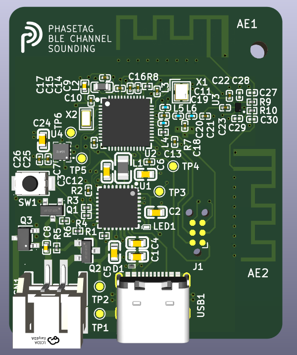
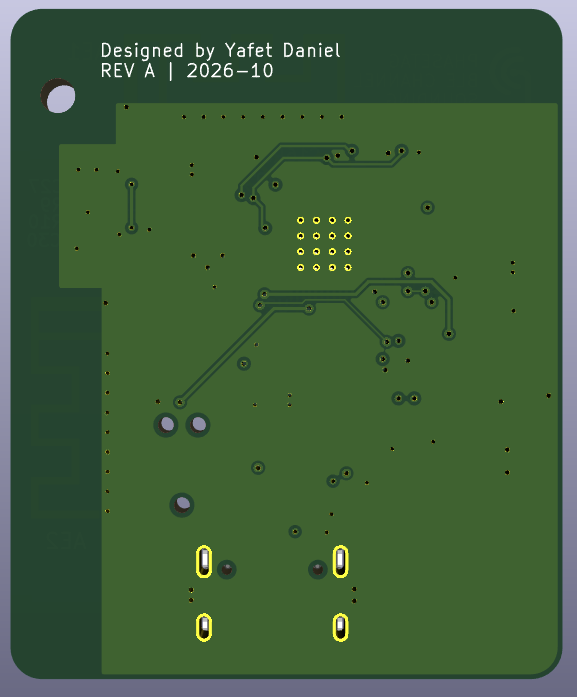
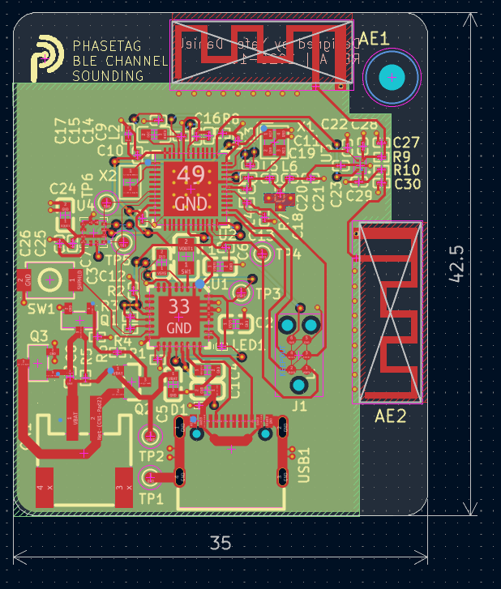

# PhaseTag

PhaseTag is a compact, rechargeable Bluetooth Channel Sounding tag designed around the Nordic nRF54L15. It brings together two selectable PCB antennas, motion sensing and USB-C charging on a **35 x 42.5 mm, four-layer PCB** designed with JLCPCB manufacturing and assembly in mind.

The aim is to explore wireless distance estimation with a compatible Channel Sounding peer and report results over BLE to a suitable host application. Motion sensing provides a basis for activity detection and low-power operation.

**Rev A is a hardware portfolio design.** Firmware, physical bring-up, antenna tuning, ranging accuracy and battery life have not been validated. The images below are KiCad renders and a PCB editor view.

## Board preview

| Top view | Bottom view |
| --- | --- |
|  |  |

### PCB layout

## Main hardware

| Block | Implementation |
| --- | --- |
| MCU and radio | Nordic nRF54L15-QFAA with 32 MHz and 32.768 kHz crystals |
| Power management | Nordic nPM1300 for single-cell LiPo charging, USB/battery power-path management and the 1.8 V rail |
| RF path | Nordic matching network, BGS12WN6 antenna switch and two perpendicular TI AN043 PCB inverted-F antennas |
| Motion sensing | ST LIS2DW12 accelerometer with an interrupt connection to the MCU |
| Power inputs | Power-only USB-C with VBUS ESD protection; 2 mm JST-PH battery connector with reverse-polarity protection |
| User interface | PMIC-controlled status LED and SHPHLD wake/recovery button |
| Programming | Six-pad Tag-Connect SWD/SWO interface, reset and target-voltage reference |
| Test access | Ground, battery, VSYS, 1.8 V, SDA and SCL test pads |

## Design choices

### Power and battery

BUCK1 supplies the 1.8 V MCU and peripheral rail. BUCK2 and both load-switch/LDO outputs are unused to keep the power circuit small. The nPM1300 allows USB to power the system while charging the battery, subject to the available input-current and power budgets. The PMIC and accelerometer share a 1.8 V I2C bus with one pair of 4.7 kohm pull-ups.

The battery sits separately from the PCB. A PKCELL LP402535, 3.7 V, 330 mAh LiPo is a candidate rather than a fixed requirement. The reverse-polarity circuit follows the approach in Analog Devices AN171, Figure 4, accommodating charging and discharge current. Battery polarity and charging limits must match the chosen pack.

Battery NTC sensing is omitted in this revision. Firmware must configure the PMIC accordingly and set the charging current, termination voltage and USB input-current limit. PMIC measurements support battery monitoring; a useful remaining-capacity estimate also requires appropriate firmware and battery characterization.

### RF and antenna selection

The MCU supply, oscillator and matching circuitry use the Nordic nRF54L15-QFAA Configuration 1 reference as their baseline. The RF switch selects one antenna at a time. The perpendicular antennas provide different orientations for evaluation; they do not operate as a combined antenna array.

Both antenna paths retain pi-matching footprints. R9 and R10 are fitted as 0-ohm links, while C27 through C30 are unpopulated. These footprints preserve tuning options for a future prototype. The TI antenna geometry is a reference starting point; copying its shape does not establish the final board's RF performance.

The nominal 50-ohm top-layer feed width retained in the design is 0.18379 mm, referenced to the adjacent inner ground layer. This target depends on the selected stackup and surrounding copper. It has not been verified by measurement.

### Compact construction and access

All components are populated on the top side. Tag-Connect programming pads avoid a fitted debug header, and the separate battery helps minimize the board area. One M2 mounting hole is provided, with a future enclosure expected to provide a second support and prevent rotation.

USB-C carries power only. Bluetooth is the intended application-data interface. Channel Sounding needs a compatible peer; ordinary BLE support alone does not make a phone suitable for ranging. Bluetooth Mesh remains a possible future firmware application.

## JLCPCB manufacturing and assembly

The fabrication target is nominal **1.6 mm, four-layer FR-4**, based on the **JLC04161H-3313** stackup:

| Layer | Purpose |
| --- | --- |
| F.Cu | Components, RF paths and signal/power routing |
| In1.Cu | Main ground reference |
| In2.Cu | Limited power routing and ground fill |
| B.Cu | Remaining signals and ground fill |

- Component selection uses JLCPCB/LCSC part numbers. Small packages, including 0201 passives, and Extended parts are accepted design tradeoffs. Stock, substitutes and assembly-service eligibility need checking when ordering.
- The **16 vias beneath the nRF exposed pad require epoxy filling and copper capping**. Identify these vias explicitly in the fabrication order; the KiCad protection settings alone are insufficient manufacturing instructions.
- Preserve the antenna keepouts and RF ground arrangement. A change in stackup requires the feed geometry to be checked again.
- Manufacturing outputs comprise Gerbers, drills, a BOM and a CPL/position file. Verify package, polarity, rotation and matching designators. Exclude DNP parts, PCB antennas, test pads, the mounting hole and logo from fitted-component data.

The reference basis also includes Nordic's nPM1300 Configuration 2 circuit, adapted for the selected power architecture, and the ST LIS2DW12 datasheet. These references inform the design; they do not replace prototype validation.

## Opening the project

Open [Bluetooth_Channel_Sounding_Tag.kicad_pro](Bluetooth_Channel_Sounding_Tag.kicad_pro) in **KiCad 10**.

- The project files contain the schematic, board and design rules.
- `Lib/` contains the imported symbols, footprints and 3D models, referenced through the project library tables. Imported absolute 3D-model paths may need remapping to this directory on another computer.
- `logo/` contains the PhaseTag logo artwork and footprint.
- `images/` contains the board renders and layout screenshot used above.

Designed by **Yafet Daniel**.
